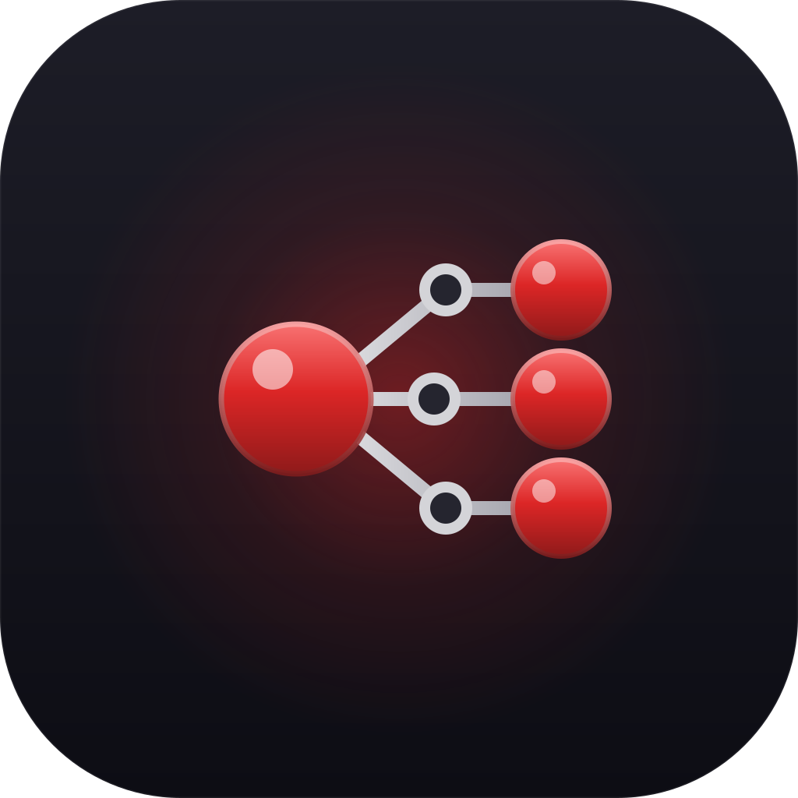

<div align="center">



# Kaflow — Native Apache Kafka GUI Desktop Client

A fast, lightweight, open-source native desktop GUI client for **Apache Kafka** on **macOS, Windows, and Linux**. Built with **Go** and **Wails v3** for a small RAM footprint and zero Electron bloat. Same native-first design language as [kaflow](https://github.com/pankaj-kumar34/kaflow) (our Redis client), with a red accent of its own.

<p>
  <a href="https://github.com/pankaj-kumar34/kaflow/releases/latest">
    
  </a>
  <a href="https://github.com/pankaj-kumar34/kaflow/actions/workflows/release.yml">
    
  </a>
  
  
  
  
</p>

</div>

---

> 🚧 **Status: under active development.** Kaflow currently runs on the kaflow (Redis) service layer while the Kafka backend is being built. See [PLAN.md](./PLAN.md) for the migration roadmap.

---

## Why Kaflow?

Most Kafka desktop clients are Electron apps (or web consoles that need a deployed server), eating hundreds of megabytes of RAM. Kaflow takes the native-first approach proven by kaflow:

- **Featherweight Native Performance**: Go backend + **Wails v3** native OS webviews (`WKWebView` on macOS, `WebView2` on Windows, `WebKitGTK` on Linux) — no Chromium, no Node runtime.
- **Production-Safe by Design**: Environment groups (`Production`, `Staging`, `Development`, `Local`) with color-coded badges and a **Read-Only Mode** per connection to block destructive mutations.
- **OS Keychain Security**: SASL secrets and SSH passphrases stay in **macOS Keychain**, **Windows Credential Manager**, and **Linux Secret Service** (`go-keyring`) — never on disk in plaintext.
- **Built-In SSH Bastion Tunneling**: Pure-Go SSH port forwarding — no external `ssh` binary required.
- **TLS / mTLS + SASL**: PLAIN, SCRAM, and mTLS client certificates for secure clusters.

## Planned Features

- **Topic Explorer**: browse topics and partitions, inspect configs, partition leaders/ISR, and log directory info.
- **Consumer Group Inspector**: group membership, partition offsets, and lag monitoring with offset reset.
- **Message Browser & Producer**: tail live messages per topic/partition, inspect keys/values/headers, and produce test records (JSON-friendly raw view).
- **Interactive Console**: run admin operations with command history and latency metrics.
- **Broker Diagnostics**: cluster/broker metrics dashboard, controller and under-replicated partition visibility.
- **Built-In Auto-Updater**: GitHub-release-backed self-update with progress events.

## Building from Source

### Prerequisites

- **Go** `1.26+`
- **Node.js** `22+` (or `24+`) and `npm`
- **Wails v3 CLI** (`go install github.com/wailsapp/wails/v3/cmd/wails3@latest`)
- **Linux only**: `libgtk-3-dev`, `libwebkit2gtk-4.1-dev`, `libsecret-1-dev`, `pkg-config`

### Local Development & Production Build

```bash
# 1. Clone the repository
git clone https://github.com/pankaj-kumar34/kaflow.git
cd kaflow

# 2. Install and build the React + TypeScript frontend
cd frontend
npm ci
npm run build
cd ..

# 3. Run backend unit tests
go test ./backend/...

# 4. Run in hot-reload development mode (Wails v3)
wails3 dev

# 5. Or compile a production binary directly
go build -tags production -trimpath -ldflags="-w -s" -o bin/kaflow .
```

---

## Keyboard Shortcuts

Press `Cmd + /` (macOS), `Ctrl + /` (Windows/Linux), or `?` anywhere outside text inputs to open the searchable **Keyboard Shortcuts** modal.

| Action                   | macOS            | Windows / Linux   |
| :----------------------- | :--------------- | :---------------- |
| **Console (Terminal)**   | `Cmd + 1`        | `Ctrl + 1`        |
| **Explorer**             | `Cmd + 2`        | `Ctrl + 2`        |
| **Diagnostics**          | `Cmd + 3`        | `Ctrl + 3`        |
| **Pub / Sub Debugger**   | `Cmd + 4`        | `Ctrl + 4`        |
| **New Connection**       | `Cmd + N`        | `Ctrl + N`        |
| **Toggle Sidebar**       | `Cmd + B`        | `Ctrl + B`        |
| **Save Changes**         | `Cmd + S`        | `Ctrl + S`        |
| **Clear Console Output** | `Cmd + K`        | `Ctrl + K`        |
| **Shortcuts Help**       | `Cmd + /` or `?` | `Ctrl + /` or `?` |

---

## Architecture & Tech Stack

| Layer                   | Technology                                                        | Role                                                                                |
| :---------------------- | :---------------------------------------------------------------- | :---------------------------------------------------------------------------------- |
| **Desktop Shell**       | [Wails v3](https://v3.wails.io/) (`github.com/wailsapp/wails/v3`) | Native OS WebView windowing, event bus, and Go-to-TypeScript RPC bindings           |
| **Backend Runtime**     | Go `1.26`                                                         | Non-blocking I/O, goroutines, connection pool management, and binary packaging      |
| **Kafka Client**        | [`franz-go`](https://github.com/twmb/franz-go) _(planned)_        | Cluster admin, consumer groups, produce/fetch with full protocol support            |
| **SSH Tunneling**       | `golang.org/x/crypto/ssh`                                         | Pure-Go SSH bastion port forwarding                                                 |
| **Secret Storage**      | [`go-keyring`](https://github.com/zalando/go-keyring)             | Native macOS Keychain, Windows Credential Manager, and Linux Secret Service         |
| **Frontend UI**         | React 19, TypeScript, Vite, Tailwind CSS v4                       | Responsive desktop UI (red accent) with Lucide icons and custom syntax highlighters |
| **List Virtualization** | `@tanstack/react-virtual`                                         | High-performance scrolling across large topic/message lists                         |

### Repository Layout

```text
kaflow/
├── main.go                          # Wails v3 entrypoint, window setup, and service registration
├── Taskfile.yml                     # Cross-platform build & dev task definitions
├── build/                           # Platform icons, Info.plist, packaging configs, and assets
├── backend/
│   ├── connection/                  # ConnectionManager, TLS & SSH tunnel, credential storage
│   ├── models/                      # Shared Go structs bound to TypeScript definitions
│   └── services/                    # Wails RPC services (Connection, Data, Cli, PubSub, Diagnostics, Updater)
└── frontend/
    └── src/
        ├── App.tsx                  # Root workspace layout, connection switching, and keyboard shortcuts
        ├── bindings/                # Auto-generated Wails v3 Go-to-TypeScript bindings
        ├── components/              # Shared UI primitives, modals, and toasts
        └── features/                # connections, explorer, editors, terminal, pubsub, diagnostics
```

---

## Contributing & License

Contributions are welcome — open an issue or pull request on [GitHub](https://github.com/pankaj-kumar34/kaflow).

Licensed under the [MIT License](./LICENSE).
